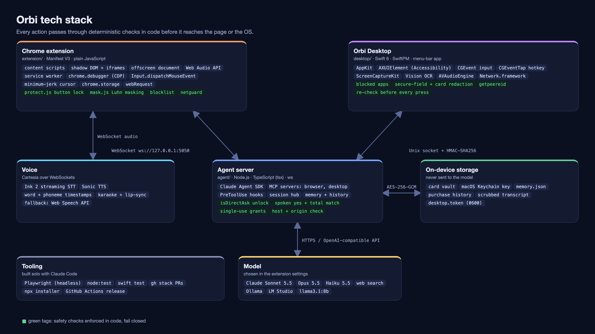
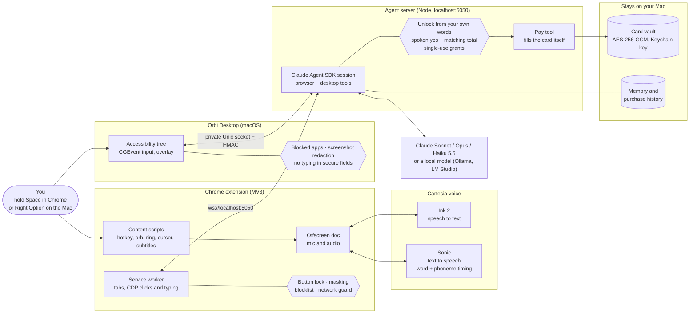

<p align="center"></p>

# Orbi

**Talk to the web.** Orbi is a voice agent for Chrome, built for blind and low-vision people and older adults, and anyone can use it. Hold Space and say what you want. It navigates, searches, reads pages to you, fills in forms, clicks, and shops when you ask, in your own Chrome.

**Guided mode** is made for blind and low-vision users. Turn it on in the popup or options page and Orbi describes each page as it lands, reads out the top choices, and lets you pick one by voice, so you never have to tab through unlabeled buttons. It is off by default for sighted users, who mostly want Orbi to just get on with it.

Orbi started with a sound screen reader users know too well: tabbing through a page and hearing "button, button, button", because nothing on it is labeled. Instead of waiting for every site to fix that, you say what you want and Orbi does the clicking.

## Quick start

You need Node 20 or newer, Chrome 116 or newer and git, plus an Anthropic API key or a local model. A Cartesia key is optional.

1. **Run setup.**

   ```bash
   npx github:SebA-R/orbi setup
   ```

   This downloads Orbi to `~/Orbi`, installs the agent server, asks for your keys (typing is hidden) and saves them to `~/.config/orbi/config.env`, which only your user account can read. Then it shows you where the extension folder is and offers to start Orbi. On macOS, add `--autostart` to start Orbi whenever you log in. From a clone, `npm run setup` does the same.

2. **Load the extension.** Open `chrome://extensions`, turn on **Developer mode**, press **Load unpacked** and choose the `extension` folder that setup printed. Finish the Orbi setup page that opens, and allow the microphone. (`npm run pack:extension` builds the extension as a zip, for sharing: unzip it somewhere it can stay and load that folder.)

3. **Hold Space on any page and talk.**

**Keys.**

- **Anthropic API key** (from [console.anthropic.com](https://console.anthropic.com/settings/keys)): Claude runs the agent. A Claude Code or Claude.ai login can't be used instead, because Anthropic only allows API keys for apps like Orbi.
- **Cartesia API key** (optional, from [play.cartesia.ai](https://play.cartesia.ai/keys)): Cartesia's natural voice and speech recognition, with subtitles timed word by word. Without it Orbi uses **basic voice**: Chrome's built-in voice reads replies, and Chrome's speech recognition hears you. Where Chrome's recognition doesn't work, type to Orbi in the toolbar popup or on the new tab page.

**No Claude key? Use a local model.** Install [Ollama](https://ollama.com), run `ollama pull llama3.1:8b`, choose option 2 in setup, then set **Model provider** to **Local** in Orbi's settings. With [LM Studio](https://lmstudio.ai), start its local server and set the local model address to `http://localhost:1234/v1`. The agent then runs on your computer, behind the same safety checks as Claude, and only talks to a model on `localhost`. Small models are slower and make more mistakes than Claude, and speech recognition still uses Cartesia or Chrome's speech service unless you type.

**Manage Orbi.** `./orbi status` shows what is set up and running (keys show only as set or not set). `./orbi start` runs the server in the background, and `./orbi stop` stops it. `./orbi uninstall` stops Orbi, turns off start on login and offers to delete your saved keys. Logs go to `~/Library/Logs/Orbi` on macOS. On Linux and Windows, start the server with `npm start` in the Orbi folder (on Windows use `node scripts/orbi.mjs <command>` for the other commands).

Why `npx` clones the repo: npx keeps its copy in a cache folder that npm can clear, and Chrome needs the extension folder to stay where you loaded it. So the npx package is only the setup script, and it puts the real Orbi in `~/Orbi` (set `ORBI_HOME` for another folder).

## Demo

<p align="center">
  <a href="https://youtu.be/5xZLOtxJtp4">
    
  </a>
  <br/>
  <sub><em>Watch the demo: <a href="https://youtu.be/5xZLOtxJtp4">Orbi: Just say it.</a> (Cal Hacks 13)</em></sub>
</p>

## Features

### Talking

- **Hold Space and talk** on any web page. Recording starts the moment the key goes down, so your first word is kept. A quick tap is still a normal Space.
- **Option+Space latches** listening, in text fields too. Press Space to send. A minute without speech stops it.
- **Double-tap Space** while Orbi is speaking to stop it.
- **Instant barge-in:** touch Space while it is talking and its speech fades out in about 20 ms, and it starts listening.
- **Speak replies off:** read answers in the subtitles without hearing them. Listening still works.
- **Ctrl+Shift+Space anywhere:** a toggle shortcut (set in `chrome://extensions/shortcuts`) for people who can't hold a key. It works on every page, even where Space can't.
- **New tab page and error pages:** Chrome's new tab page and "can't reach this site" page can't run extensions, so Orbi replaces them with its own pages, where Space and subtitles work. Both can be turned off.

### Seeing what it does

- **Karaoke subtitles:** each reply shows at the bottom of the tab, and each word lights up as you hear it, timed from Cartesia Sonic's word timestamps.
- **Orb face:** a small orb shows the voice state with a face: resting, listening, thinking and speaking. While it speaks, the mouth follows the words, timed from Sonic's phoneme timestamps.
- **R1 ring:** the orb wears a thin spectrum ring. It turns slowly at rest, splits into eight arcs and grows while Orbi thinks, and pulses with your voice while it listens. With reduced motion turned on, it stays still.
- **Extension icon:** the toolbar icon is the same orb face in its ring, readable on light and dark toolbars.
- **Active-tab ring:** an 8px rotating spectrum ring with rounded corners frames the tab Orbi is working in.
- **Humanized cursor and typing:** Orbi's own pointer moves along curved paths at a pace you can follow, with a ripple on each click. Typing goes key by key at a typist's cadence. Your own mouse never moves.
- **Follows you to its tab:** when it opens, clicks, types or scrolls in a tab, that tab comes to the front. If you switch away yourself, it stops following until your next turn.
- **Quiets other tabs:** videos and music in other tabs fade out while you talk and while it answers, then come back.
- **Sounds:** short cues for listening, sent, cut off, order placed, order not placed, errors and a lost connection.

### Memory

- **Remember and forget:** say "remember that I wear a medium" and it keeps that fact on this computer. Ask what it remembers, or tell it to forget. The options page lists saved facts and has Forget everything.
- **Survives restarts:** the last two hours of the conversation (your words and its spoken replies only) come back after a restart.
- **Past purchases:** orders Orbi places are saved on this computer (item, store, size, price and date, up to 100). Say "I bought running shoes from Nike" and it adds that too. Orbi uses them for advice like "you got a medium last time". Ask what it remembers to hear them, or tell it to forget them.
- Memory refuses card numbers, passwords, IDs, bank details and other secrets, and can be turned off. With Memory off, no purchases are recorded or used.

### Shopping help

- **Web search (Claude only):** Orbi can search the web for loyalty perks, promo codes, prices at other stores, return policies and reviews before you buy. Searches never include your personal details and are paused while a card form is open. Results are treated as untrusted data. The local model has no web search.

### Trust and safety

- **Locked risky buttons.** Place order, Buy now, Pay, Checkout, wallet buttons (Apple Pay, Google Pay, PayPal and others), Subscribe, Save card, Sign in and Sign up are locked for the AI, along with the submit of any card or password form. Every agent click, key and form change is checked against the page before it is sent, and refused if the check can't run.
- **Unlocked when you ask.** Say "sign me in" or "go to checkout" and that one control unlocks once, for that tab. Anything less direct gets one spoken question, and only a clear yes unlocks it. Place order and wallet buttons never unlock this way.
- **Checkout read-back and a spoken yes.** Before paying, Orbi reads back the item and the total. Only an explicit "yes" confirms, and the total on the page must match what you heard.
- **The card and passwords are never visible to the agent.** Page reads mask card and password fields and card-like numbers. The agent can't type into them. Cards you save in Orbi's settings are encrypted on this computer and filled by Orbi's own code, and the model only ever gets back a card's nickname and last four digits.
- **Blocked sites.** A suggested list of sensitive sites (email, password managers, banks, government, health, account pages) is blocked from the start, and you can edit it. Browser pages, local network addresses and addresses with a login in them are always blocked.
- **Page text is data, not instructions.** Page content, your selection and earlier conversation reach the model labeled as data, and the prompt tells it never to follow instructions found in them.
- **CAPTCHA hand-off.** Orbi never tries to solve a CAPTCHA or bot check. It tells you, and you take over.
- **Limits.** The lock and masking are enforced in code. Some rules are only instructions to the model, such as not typing other personal details like your address. Details are in [`extension/README.md`](extension/README.md#button-lock).
- **One global session.** Every Orbi window shares one agent. The window you last talked into owns it, so one yes can never confirm two checkouts.
- **Danger mode (opt-in, off by default).** Danger mode turns Orbi into a free agent: no button lock at all, no checkout page block, and it places orders without waiting for a yes (it announces the item and total, then presses the button). It still can't see or type card numbers or passwords, so on most sites an order only goes through where the site already has your payment and sign-in saved. With a card saved in Orbi's settings, Orbi's own code fills it without asking. Card and password masking, blocked sites and the CAPTCHA hand-off stay on. The risk is real: a misheard request or a misleading page can lead to a real purchase you didn't intend. Turning it on takes a second confirming press.

### Pay

Save a card in Orbi's settings under **Payment cards**. Orbi encrypts it on this computer (AES-256-GCM, with the key in your macOS Keychain), and the AI never sees it. Paying runs through the read-back and your spoken yes. Right after the yes, Orbi's own code (not the AI) checks the total on the page again, fills the saved card in, including card fields inside a payment provider's frame, and presses Place order once. This works on any checkout page Orbi may use; blocked sites stay blocked. With no card saved, Orbi stops at checkout, reads you the order and lets you finish it yourself.

**Stripe test checkout demo.** Orbi can pay on Stripe's hosted checkout in test mode only (`buy.stripe.com/test_` links and `cs_test_` sessions; live Stripe pages never count). It checks the total, presses Pay exactly once and confirms Stripe's thank-you page. The setup takes about three minutes: see [`docs/demo/STRIPE.md`](docs/demo/STRIPE.md).

## How it works





- **The extension** (Manifest V3, `extension/`) does everything in the browser. Content scripts catch the talk key and draw the subtitles, orb, ring and cursor. An offscreen document owns the mic, streams your speech to Cartesia Ink 2 speech-to-text, and plays replies from Cartesia Sonic text-to-speech with word timestamps for the karaoke subtitles. Without a Cartesia key it switches to basic voice: Chrome's speech recognition and Chrome's built-in voice. The service worker connects to the agent server and runs its browser tools: tabs, navigation, page reading, form input, and clicks and keys over the Chrome debugger.
- **The agent server** (`agent/`) runs Claude through the Claude Agent SDK with model `claude-sonnet-5-5` (the extension's Claude model setting picks Sonnet, Opus or Haiku 5.5, or `CLEARCART_MODEL` when the extension has not; any other name falls back to Sonnet), or a local model through Ollama or LM Studio with the same tools, guard and hooks. It keeps one global session, the memory and past purchases, web search (Claude only), and the checkout and pay tools.
- **Safety sits between the model and the page in layers.** The prompt sets the rules. The agent server checks every tool call before it runs (blocked sites, checkout URLs, the card guard while a card is in the form) and sweeps tabs after. The extension checks every click, key and form change against the live page and refuses locked controls, so a model mistake or a page trying to trick it still can't press Place order. Only `pay_with_saved_card` can, through a single-use unlock that needs your spoken yes.

## Honest limits

- **Small local models are weaker.** They are slower, make more mistakes than Claude and have no web search.
- **Basic voice is basic.** Chrome's speech recognition isn't documented to work in an extension's offscreen page, so on some setups it won't hear you, and then you type to Orbi instead. Chrome's own voice sounds flatter than Sonic, and some voices send no word timing, so subtitles show the whole line at once.
- **Paying is narrow on purpose.** Orbi's own code pays only on pay sites you list and on Stripe's test checkout. It reads only the top frame, so card forms inside iframes (such as `checkout.stripe.dev`) aren't supported. Everywhere else it stops at checkout and you finish.
- **Card storage is macOS only.** The card lives in the macOS Keychain. Autostart is macOS only too.
- **Some rules are only instructions to the model.** The button lock, masking and blocklist are code. Not typing your address or other personal details unless asked is a prompt rule, and a model can get it wrong.
- **CAPTCHAs stop it.** It hands over to you rather than solving them.
- **It can misunderstand.** A misheard word or a misleading page can send it the wrong way. That is why risky buttons need your spoken yes, and why Danger mode stays off unless you turn it on.
- **Built in a weekend.** It has tests, not real-world mileage. Treat it as a prototype.

## Manual setup

Quick start's setup command does all of this for you. To do it by hand:

1. **Clone and install the agent server.**

   ```bash
   git clone https://github.com/SebA-R/orbi.git
   cd orbi
   npm --prefix agent install
   ```

2. **Set your keys.** Copy `.env.example` to `.env` (gitignored) and set:
   - `ANTHROPIC_API_KEY` (not needed with a local model)
   - `CARTESIA_API_KEY` (optional: without it Orbi uses basic voice)
   - `CLEARCART_VOICE`: `true` for voice, `false` for text and subtitles only, with no speech at all
   - `CLEARCART_BROWSER=ext`, so the server drives the Orbi extension

   The server reads the process environment first, then `.env`, then the config file setup writes (`~/.config/orbi/config.env`, or `ORBI_CONFIG`). The environment variables keep the `CLEARCART_` prefix from the project's old name, Clearcart, so existing setups keep working.

3. **Start the agent server** on port 5050:

   ```bash
   npm --prefix agent start
   ```

4. **Load the extension.** Open `chrome://extensions`, turn on **Developer mode**, press **Load unpacked** and choose the `extension/` folder. The server log should say `ext: extension connected`.

5. **Finish the first-run setup page.** It opens on install and checks site access, the microphone, the agent server and the talk key, each with one button. Grant the microphone when Chrome asks. The toolbar icon shows **!** until setup is done, and you can run it again from the options page.

6. **Hold Space on any page and talk.**

**Optional: paying.** Add a card in Orbi's settings under **Payment cards**, or run `npm --prefix agent run add-test-card` once to save the published Visa test card (4111 1111 1111 1111).

**Tip: hide the debugging bar.** Chrome shows "Orbi started debugging this browser" while the agent clicks or types. Quit Chrome and relaunch it with `--silent-debugger-extension-api` to hide the bar:

```bash
open -a "Google Chrome" --args --silent-debugger-extension-api
```

The tradeoff: the flag hides that warning for every extension, so you would no longer see when any extension is debugging your browser. Use it for demos and recordings, not everyday browsing.

More options for the server are in [`agent/README.md`](agent/README.md), and extension internals are in [`extension/README.md`](extension/README.md).

## Settings

All settings live in the extension's options page. The everyday ones are also in the toolbar popup.

| Setting | Default |
| --- | --- |
| Talk key (Space, Option+Space, Ctrl+Shift+Space or F9) | Space |
| Speaking speed (0.6 to 2) | 1 |
| Speak replies | On |
| Guided mode | Off |
| Browse mode (Open web or Only allowed sites) | Open web |
| Allowed sites | None |
| Blocked sites | The suggested list |
| Follow Orbi to its tab | On |
| Show actions at a watchable pace | On |
| Show Orbi's cursor | On |
| Danger mode | Off |
| Remember things about me (Memory) | On |
| Show subtitles on the page | On |
| Use the Orbi new tab page | On |
| Replace Chrome error pages with Orbi's page | On |
| Play sounds | On |
| Quiet other tabs while talking | On |
| Model provider (Claude or Local) | Claude |
| Local model address and name | `http://localhost:11434/v1`, `llama3.1:8b` |
| Agent server address | `ws://localhost:5050` |

## Testing

Run the light tests without Cartesia: `CLEARCART_VOICE=false npm --prefix agent test`, `npm run test:installer` for the setup command (and `npm --prefix tests/extension install && npm --prefix tests/extension test` for the extension unit tests).

## Tracks and credits

Orbi was built at **Cal Hacks 13.0** (October 24 to 25, 2026) for the Visa, Anthropic, Cartesia and Microsoft tracks:

- **Visa:** agent checkout where the card never reaches the model and nothing is bought without a spoken yes.
- **Anthropic:** the agent runs on Claude through the Claude Agent SDK.
- **Cartesia:** Ink 2 speech-to-text and Sonic text-to-speech, with word timestamps driving the subtitles.

Credits:

- **Claude Code** is a co-author on the commits in this repository.
- **Cartesia**, for the Ink 2 and Sonic APIs. **Anthropic**, for Claude and the Claude Agent SDK.
- **Open Claude in Chrome** by Sebastian Sosa / noemica (https://github.com/noemica-io/open-claude-in-chrome), the earlier browser path, still available when `CLEARCART_BROWSER` is unset. Its LICENSE is the PolyForm Noncommercial License 1.0.0. It is a git submodule under `vendor/` and is not part of this project's code.
- Earlier demo material in [`docs/demo/`](docs/demo/) credits its music in [`docs/demo/CREDITS.md`](docs/demo/CREDITS.md).

Never commit API keys: they belong in the setup config file (outside the repo) or in `.env`, which is gitignored.

## License

MIT. See [LICENSE](LICENSE). Third-party code keeps its own license.
