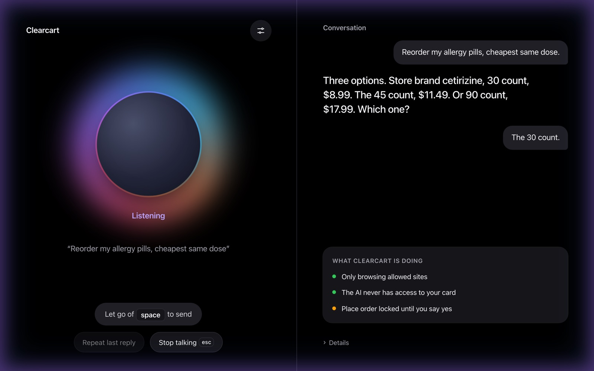
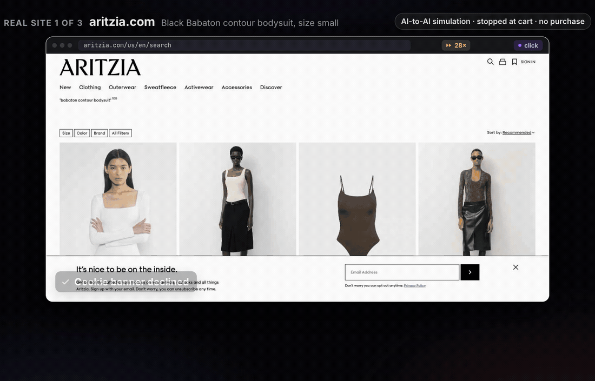
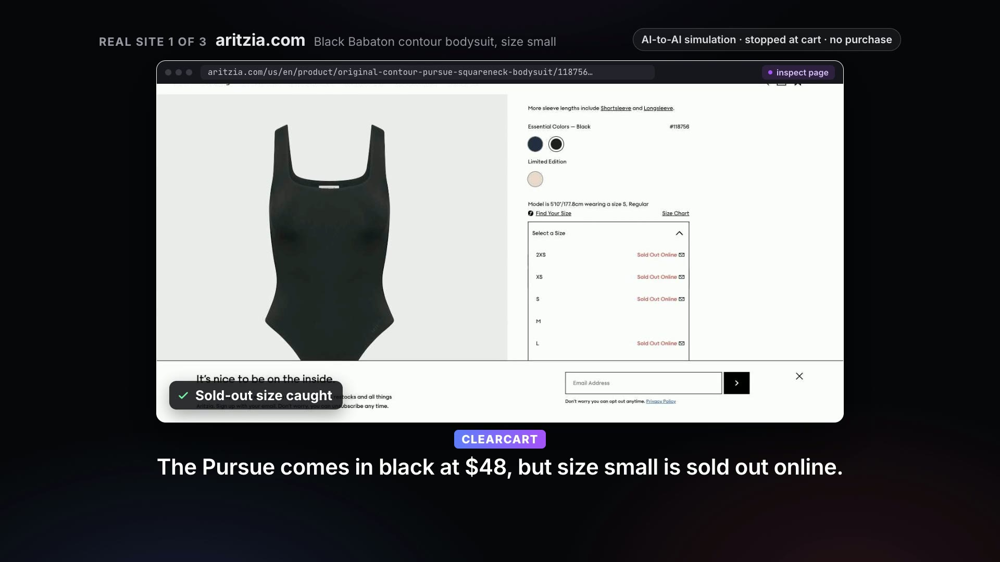
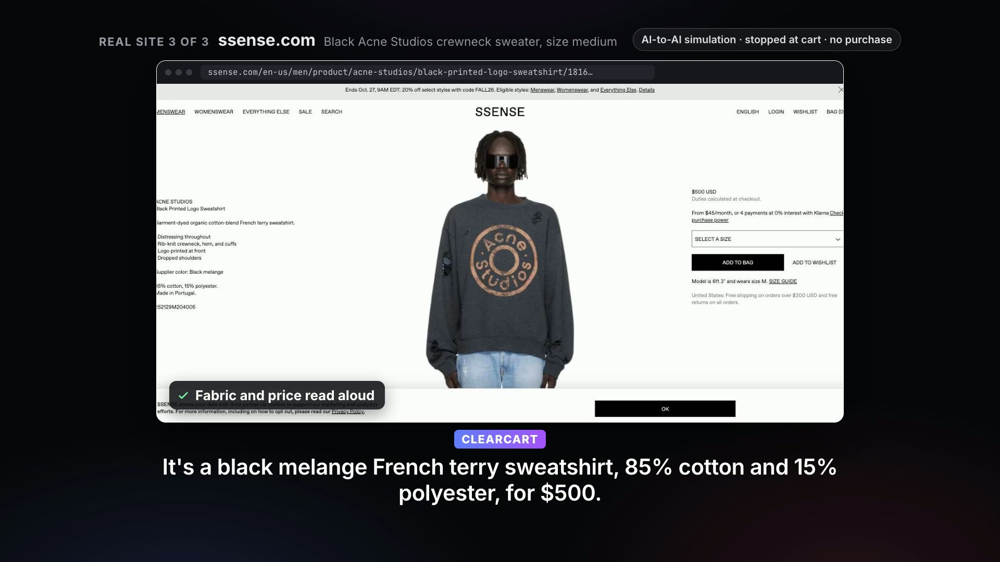
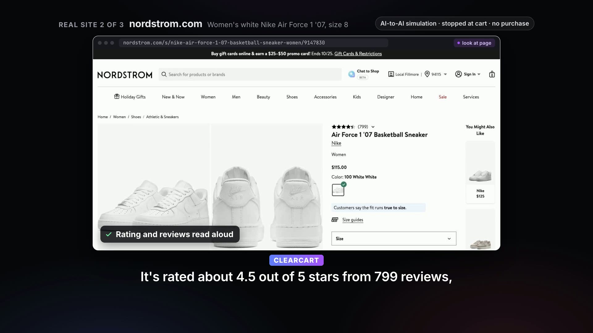
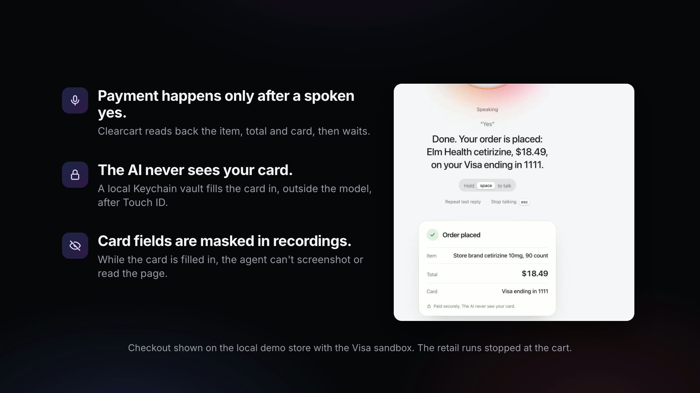
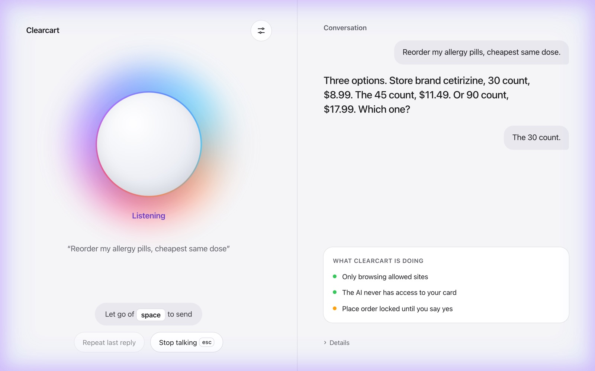
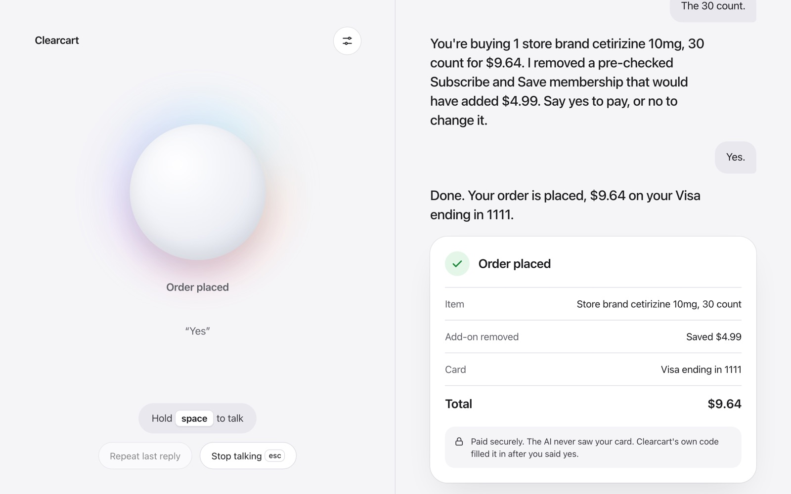
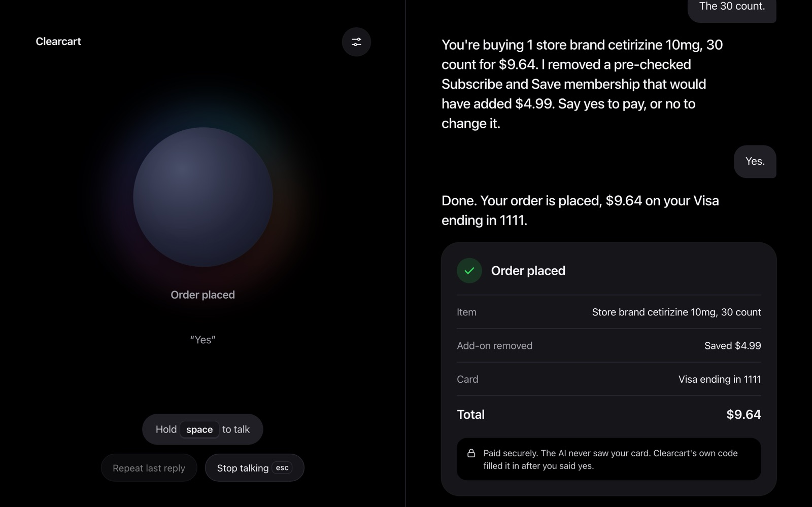
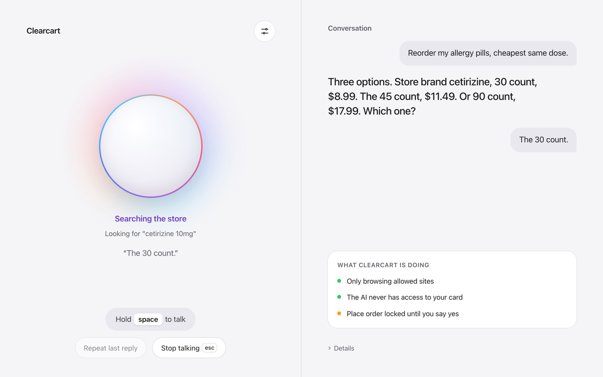

# Clearcart

**Talk to the web.** Clearcart is a voice-controlled web agent for anyone. Hold Space and say what you want: it navigates, searches, reads and summarizes pages, fills in forms when you ask, clicks, and shops when you ask, in your own Chrome. **Guided mode** is made for blind and low-vision users: Clearcart describes each page, reads out the choices and lets you pick. When it shops, the AI agent never has access to your card: it can't see it, read it or type it, and nothing is bought without your spoken yes.

**[Watch the demo video (2:38)](docs/demo/clearcart-demo.mp4)**

## How it works

1. **Hold Space and talk.** The voice console streams your speech to Cartesia Ink 2 speech-to-text.
2. **Claude works out the steps.** Each finished turn goes to a Claude agent (Claude Agent SDK, `claude-sonnet-5-5`).
3. **Browser tools do the clicking.** The agent opens sites, searches, reads pages, fills in forms when asked, closes pop-ups without accepting them and adds to the cart through the Clearcart extension (or Open Claude in Chrome).
4. **When it shops: a read-back, then a spoken yes.** Before paying, Clearcart reads back the item and the total. Only an explicit "yes" confirms the order.
5. **The agent never touches the card.** The card is filled in automatically by Clearcart's payment step, not by the AI. The agent has no tool that can read the card, and while the card is in the form it can't screenshot, read or type into the page. All it gets back is "paid, card ending 1111".
6. **Spoken receipt.** Cartesia Sonic reads the order back, and the console shows a receipt card.

## Button lock

Clearcart's AI can never press the button that spends your money. Place order, Buy now, Pay, Checkout, Apple Pay, Google Pay, PayPal and similar wallet buttons, Subscribe, Save card, Sign in and Sign up are locked for the agent, along with the submit of any form that holds card or password fields. Pre-checked add-on and subscription boxes may be unchecked, never checked. Add to cart, quantity and remove stay open, so shopping works as before.

- **Enforced in code, not just asked for.** Every agent click (by element or by screen position), Enter or Space key, typed newline and form change is checked against the page before it is sent, and refused if it would press a locked control. If the check cannot run, the action is refused. Checkout and payment pages open only when you ask to check out, or on a pay site you set up.
- **One way through.** Only Clearcart's own pay code presses the order button, once, after your spoken yes, on a pay site (none unless you add them), with the total you heard. The AI cannot unlock anything.
- **Only the AI is locked out.** You can always press any button yourself. Locked controls and card fields look grayed out, with a small "Locked for AI" padlock, for sighted helpers and the demo video. Both are visual only: nothing is disabled, clicks go through, and what a screen reader says does not change.
- **Still prompt-only:** on real stores the checkout, wallet and sign-in buttons are locked, but not typing other personal details (an address, for example) is only an instruction to the model. Details and limits are in [`extension/README.md`](extension/README.md#button-lock) and [`agent/README.md`](agent/README.md#button-lock).

## Which sites it browses

By default Clearcart browses the open web: any site you name, such as a news site, a recipe site or a store like Etsy, Aritzia or Nordstrom. It never opens the blocked sites you keep in the extension's options. On install that list is filled with suggested sensitive sites (email, password managers, banks, brokerages and crypto exchanges, government and tax, health portals, Google, Apple, Microsoft and Amazon account pages), which you can edit or restore. Browser and extension pages, addresses with a login in them, and other ports on this computer and other devices on your network are always blocked, however the address is written and even when a normal-looking name points there (the extension checks the address each page actually came from). It only ever drives tabs in its own "Clearcart" tab group, never your other tabs, and on real stores it stops at the cart: the button lock and the checkout page block stay on, and open browsing does not make any site a pay site.

To limit it to a fixed list instead, set `CLEARCART_BROWSE_MODE=allowlist` for the agent (with `CLEARCART_ALLOWED_ORIGINS`) and pick "Only these sites" in the extension's options. `CLEARCART_BLOCKED_ORIGINS` adds blocked origins on the agent side. Details are in [`agent/README.md`](agent/README.md) and [`extension/README.md`](extension/README.md#which-sites).

## Demo examples

These runs used real retail sites, but they are **AI-to-AI simulations**: a separate Claude call played a blind shopper, both sides were voiced afterwards with Cartesia Sonic, every run stopped at the cart and nothing was bought. Full transcripts and notes are in [`docs/demo/raw/`](docs/demo/raw/).

**Aritzia: a sold-out size and a smart alternative**

> **Shopper (AI):** Hi, I'm looking for a black Babaton contour bodysuit on Aritzia, in a size small. Can you help me find it and tell me the price and fabric?
>
> **Clearcart:** Closing the cookie banner without accepting.
>
> **Clearcart:** The Pursue comes in black at forty-eight dollars, but size small is sold out online. The fabric is ninety-four percent nylon and six percent elastane, machine washable. Medium is still available online, and I can also check the Manner or Float Cami in small if you'd like.
>
> **Clearcart:** The Original Contour Float Cami Bodysuit, black, size small, is in your Aritzia bag. The quantity is one, at forty-eight dollars. The estimated total is fifty-eight twenty-eight, which includes seven fifty for shipping and about two seventy-eight for tax. I haven't started checkout, and the cart page is open for you.

**Nordstrom: price, rating and reviews read aloud**

> **Clearcart:** I found them. The women's Nike Air Force 1 '07 Basketball Sneaker in white is $115 on Nordstrom. It's rated about 4.5 out of 5 stars from 799 reviews, and size 8 is listed with no sold-out note. I haven't added anything to your cart.
>
> **Shopper (AI):** Great, thanks. Can you add the white size 8 to my bag, please?
>
> **Clearcart:** I added the white women's Nike Air Force 1 '07 in size 8 to your bag, and the bag page is open. The shoes are $115, shipping is free, and the estimated total with tax is $124.92. I haven't started checkout, because I can't do that on Nordstrom.

**SSENSE: medium sold out, fabric checked on the alternative**

> **Clearcart:** Yes, it's a crewneck, with a rib-knit neck, hem, and cuffs. But medium is sold out. Only extra small and small are left, with one of each. It's a black and gold shag knit with an argyle pattern. It's 55 percent nylon and 45 percent metallic fiber. Do you want me to check the black printed logo sweatshirt instead?
>
> **Shopper (AI):** Yeah, please check that one. Is it a crewneck, is it in medium, and what's it made of?
>
> **Clearcart:** This one is a crewneck, with a rib-knit neck, hem, and cuffs. It comes in medium, and four are left. It's a black melange French terry sweatshirt, 85 percent cotton and 15 percent polyester, for $500. Do you want me to add the medium to your bag?

| Aritzia | SSENSE |
| --- | --- |
|  |  |
| **Nordstrom** | **Payment safeguards** |
|  |  |

## Screenshots

| Light | Dark |
| --- | --- |
|  |  |
|  |  |
|  | |

## Stack

- **Voice:** Cartesia Ink 2 speech-to-text (`/stt/turns/websocket`) and Cartesia Sonic text-to-speech (`/tts/websocket`)
- **Agent:** Claude via the Claude Agent SDK (TypeScript), model `claude-sonnet-5-5`
- **Browser automation:** the third-party extension Open Claude in Chrome, plus our own add-ons
- **Payment vault:** the card is stored in the macOS Keychain and filled in automatically by Clearcart's payment step. The agent never has access to it (a Touch ID prompt is planned, not built yet)
- **Payments:** the Visa Acceptance sandbox

## Layout

| Path | Contents |
| --- | --- |
| `agent/` | Claude Agent SDK voice agent server |
| `voice/` | Cartesia STT/TTS client |
| `extension-addons/` | Our changes on top of Open Claude in Chrome (side panel, payment fill, redaction) |
| `vault/` | Keychain card reader and test card setup script |
| `docs/` | Design notes and documentation; `docs/demo/` has the demo video, credits and raw runs |
| `vendor/open-claude-in-chrome/` | Git submodule for Open Claude in Chrome (third-party) |

## Setup

Needs macOS (for the Keychain), Node 20 or newer and Chrome.

1. **Clone with the submodule:** `git clone --recurse-submodules <repo>`, then install the Open Claude in Chrome extension from `vendor/open-claude-in-chrome/`.
2. **Keys:** copy `.env.example` to `.env` and fill in `ANTHROPIC_API_KEY` and `CARTESIA_API_KEY` (the `VISA_ACCEPTANCE_*` keys are for the sandbox). `.env` is gitignored.
3. **Vault:** run `./vault/setup-test-card.sh` once. It stores the published Visa test card in your login Keychain.
4. **Agent and voice console:** `cd agent && npm install && npm start`, then open http://localhost:5050 and hold Space to talk. See [`agent/README.md`](agent/README.md) for options.
5. **Voice only (optional):** `cd voice && npm install && npm start` runs the console against an echo agent at http://localhost:5051.

## Third-party code and credits

- **Open Claude in Chrome** by Sebastian Sosa / noemica (https://github.com/noemica-io/open-claude-in-chrome). Its LICENSE file is the PolyForm Noncommercial License 1.0.0, even though its README says MIT. We use it as a dependency through a git submodule, and its code is not part of this project.
- **Cartesia**, for the Ink 2 speech-to-text and Sonic text-to-speech APIs.
- **Anthropic Claude**, through the Claude Agent SDK.
- **Demo video music:** "Deliberate Thought" by Kevin MacLeod (incompetech.com), CC BY 4.0. See [`docs/demo/CREDITS.md`](docs/demo/CREDITS.md).

Clearcart is not affiliated with Aritzia, Nordstrom or SSENSE.

## Hackathon

This project was started at Cal Hacks 13.0 (October 24-25, 2026). All of the code in this repository was written during the event.

## Testing without voice

Set `CLEARCART_VOICE=false` (in `.env` or the environment) to run the agent server without Cartesia: no voice tokens are minted, replies show as text and subtitles only, and no credits are spent. The e2e and server tests set it automatically. Unset or `true` keeps voice on.

## Secrets

Never commit API keys. Copy `.env.example` to `.env` and put your keys there. `.env` is gitignored.

## License

MIT. See [LICENSE](LICENSE). Third-party code listed above keeps its own license.
